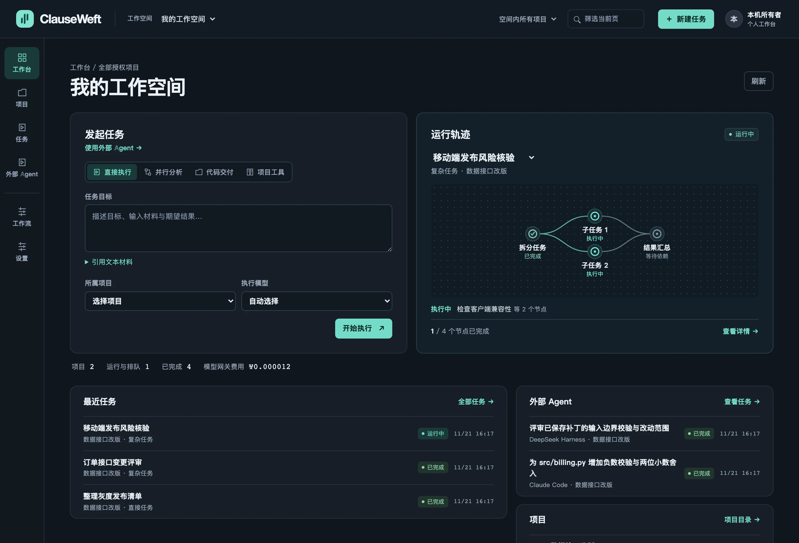
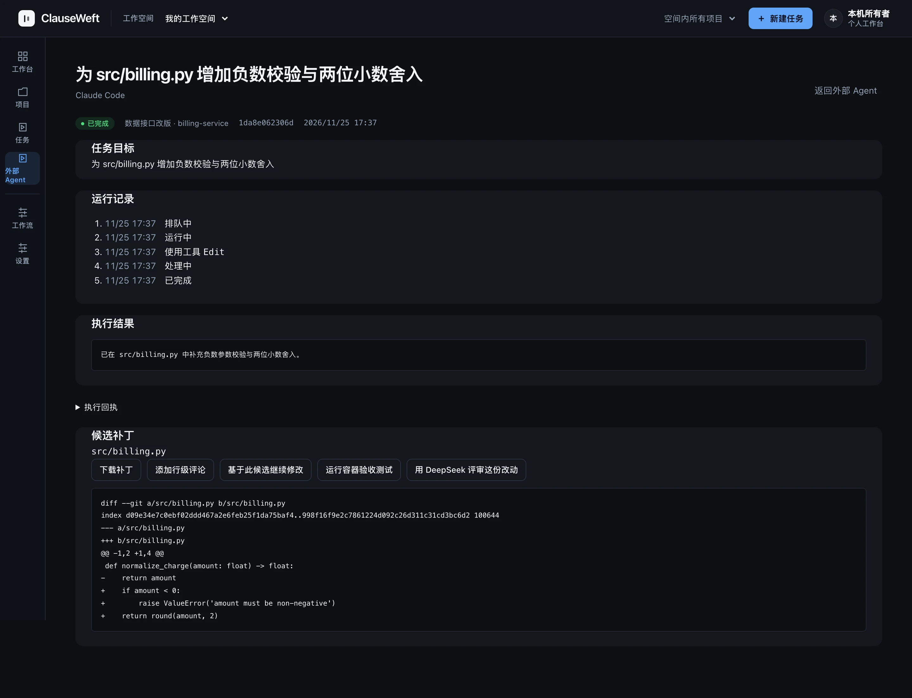

# ClauseWeft

**Local-first personal AI engineering workbench for multi-model orchestration, isolated external agents, and verifiable code delivery.**

English | [简体中文](README.zh-CN.md)

[](#quick-start)
[](#quick-start)
[](LICENSE)

ClauseWeft keeps your projects, tasks, execution records, model usage ledgers, and candidate patches on your own machine. It runs entirely on the **Python 3.11+ standard library** with single-instance SQLite persistence and a separate model gateway. You can ask a model directly, fan out parallel analysis branches and aggregate conclusions, run human-approved project tools, or dispatch an isolated external agent (**Claude Code** / **DeepSeek Harness**) against a Git repository and inspect every diff and receipt.



*Live screenshot of the ClauseWeft 0.0.1 personal workbench showing task submission, an active parallel execution graph (`plan → branch-1 & branch-2 → summary`), recent runs, and external agent jobs. Also available in [Light Mode](docs/images/workbench-light.webp) and [Mobile Layout](docs/images/workbench-mobile.webp).*

---

## Key Capabilities

| Workflow | Mode / Entry | What Happens |
|---|---|---|
| **Direct Q&A & Drafting** | `single` (default) | Query a configured model with optional local UTF-8 materials, personal preferences, or a versioned workspace role & skills. Supports follow-up conversations and regeneration. |
| **Parallel Analysis & Synthesis** | `complex` | Set a total budget; a planner proposes sub-tasks, workers execute branches concurrently under one dependency graph, and a synthesizer aggregates the results after all branches succeed. |
| **Human-Approved Project Tools** | `mode=tool` | Search project requirements, query local knowledge bases, or propose new requirements with duplicate checks. Each tool step waits for explicit approval and records its receipt. |
| **Verifiable Code Delivery** | `workflow` | Provide a registered repository, base commit SHA, acceptance test suite, and budget. Built-in gates enforce requirement baseline approval, independent review, path-scoped patch integration, and pinned Docker test execution. |
| **Isolated External Agents** | **External Agent** (`#agents`) | Run **Claude Code** inside an isolated container to edit allowlisted files in a Git repo, inspect/download the generated Git patch, and trigger read-only **DeepSeek Harness** review on the frozen candidate. |
| **Reusable SOP Templates** | Published SOP (`template_id`) | Execute version-frozen SOP graphs composed of model nodes, roles, dependencies, and human approval gates. |

### External Agent Execution & Frozen Candidate Review



*Live screenshot of an isolated Claude Code job: event timeline, execution summary, downloadable Git diff, and one-click DeepSeek Harness read-only review on the frozen candidate.*

- **Auditable by design**: Dispatch intents, frozen model prices, actual token receipts, request contexts, checkpoints, and hash-chained audit logs are committed atomically in SQLite and can be exported and verified offline (`clauseweft audit --input ...`).
- **Strict data-scope & budget control**: Local-only tasks never route to cloud endpoints; usage is accounted per model revision and currency without fabricated estimates.
- **Zero-dependency Python core**: No external runtime packages required; an isolated HTTP model gateway (`clauseweft-gateway`) keeps provider API keys out of the workbench process.

---

## Quick Start

### Run from Source

Requires **Python 3.11+**. Run from the repository root:

```sh
PYTHONPATH=src python3.11 -m clauseweft --version
PYTHONPATH=src python3.11 -m clauseweft doctor
PYTHONPATH=src python3.11 -m clauseweft serve --config examples/workbench.json --state ~/.local/share/clauseweft
```

1. Open the loopback URL printed in your terminal (default: `http://127.0.0.1:8766/`).
2. In **Personal Pairing**, enter the local access token printed at startup (for background runs, pass it via `CLAUSEWEFT_CONSOLE_TOKEN`). Existing team deployments can sign in via the account tab.
3. Configure your own model endpoints in the [independent gateway](src/clauseweft/gateway/README.md), register them in **Resources & Admin → Models**, authorize them to your workspace, and start submitting tasks. ClauseWeft ships no preconfigured commercial models or fabricated pricing.
4. For **External Agent** coding and review (Claude Code & DeepSeek Harness), build the locked agent image from `examples/agent-image` and register your runner and allowlisted repository. See [Personal Workbench & External Agents](docs/12-个人工作台与外部Agent.md).

### Install in a Virtual Environment

```sh
python3.11 -m venv .venv
. .venv/bin/activate
python -m pip install .
clauseweft --version
clauseweft doctor
clauseweft serve --config examples/workbench.json --state ~/.local/share/clauseweft
```

On Windows PowerShell, activate the environment with `.venv\Scripts\Activate.ps1`. Keep `--state` on trusted local storage outside any tested Git repository.

### Reproducible Offline Routing Preview

Test the deterministic model router locally without starting any server or calling external APIs:

```sh
PYTHONPATH=src python3.11 -m clauseweft route --input examples/route-demo.json
```

In [examples/route-demo.json](examples/route-demo.json), the task enforces `data_scope: "local_only"`, so `local-review` is selected even though `cloud-general` is cheaper. Changing `task.data_scope` to `"public"` on a copy allows the cloud candidate to compete in ranking.

---

## Delivery Scope & Architecture

- **Runtime**: Single-instance Python 3.11+ modular monolith (17 registered modules) backed by SQLite and content-addressed artifacts.
- **Access Model**: Personal owner mode via local pairing, plus shared team roles (`admin`, `operator`, `viewer`) with explicit workspace and project allowlists enforced server-side across menus, direct URLs, and APIs.
- **Audit & Checkpoints**: Versioned skills participate in model context; stable runs support checkpoints and forked runs with independent budgets and re-approval. Exported audit bundles can be verified offline via `clauseweft audit --input FILE`.
- **Upgrades**: Stop the running server and start the new version pointing `--state` at the same state directory; runs, requirement revisions, candidate SHAs, and test history are preserved.
- **Out of Scope for 0.0.1**: SSO, per-project custom RBAC overrides, multi-tenant infrastructure isolation between untrusted organizations, distributed workers, arbitrary third-party CLIs, MCP servers, and automatic remote Git push / PR creation.

---

## Verification & Testing

```sh
# Unit & local integration test suite
PYTHONPATH=src python3.11 -m unittest discover -s tests

# Include real Docker container acceptance tests
CLAUSEWEFT_TEST_IMAGE="$(docker image inspect --format '{{.Id}}' python:3.11-slim)" \
  PYTHONPATH=src python3.11 -m unittest discover -s tests -v

# Distribution & release safety checks
python3.11 scripts/check_distribution.py source
python3.11 scripts/check_release.py --checkout
```

Full CI matrix details (including locked agent image tests, Playwright browser E2E, and npm lockfile auditing) are in [.github/workflows/ci.yml](.github/workflows/ci.yml).

---

## Documentation

Most design and operational docs are written in Simplified Chinese:

| Area | Documents |
|---|---|
| **Product & Guides** | [中文 README](README.zh-CN.md) · [Tasks & Model Usage](docs/11-任务执行与模型用量.md) · [Personal Workbench & External Agents](docs/12-个人工作台与外部Agent.md) · [Workspaces & Permissions](docs/10-工作空间与权限.md) · [Product Requirements](docs/01-产品需求.md) · [Acceptance Baseline](docs/02-需求评审.md) · [Comparative Study](docs/03-竞品调研.md) |
| **System Design** | [Architecture & Modules](docs/04-概要设计.md) · [API & Transactions](docs/05-详细设计.md) · [Agent Design](docs/08-Agent设计.md) · [Harness & Audit](docs/09-Harness能力与审计.md) |
| **Build & Operations** | [Build, Run & Verification](docs/06-构建与运行.md) · [Gateway Design](docs/07-Gateway详细设计.md) · [Workbench API Reference](src/clauseweft/api/README.md) · [Gateway Guide](src/clauseweft/gateway/README.md) |
| **Community** | [Contributing](CONTRIBUTING.md) · [Coding Agent Guide](AGENTS.md) · [Security Policy](SECURITY.md) |

---

## License

Code and accompanying documentation are released under the [MIT License](LICENSE). Third-party external CLIs (such as Claude Code and DeepSeek Harness) and upstream model providers remain subject to their respective licenses and terms of service.
