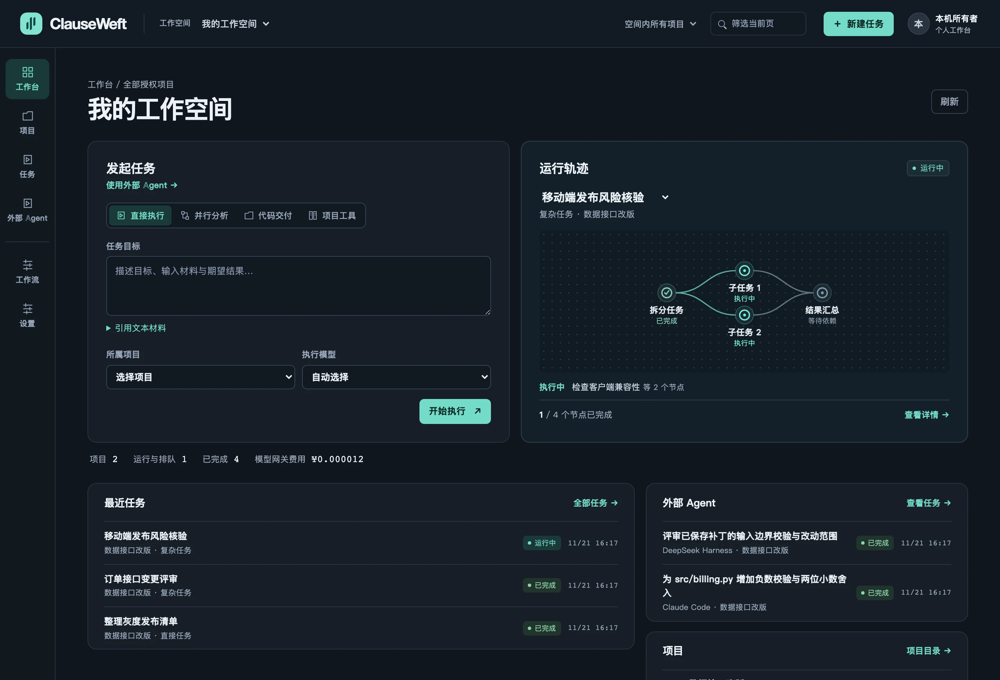
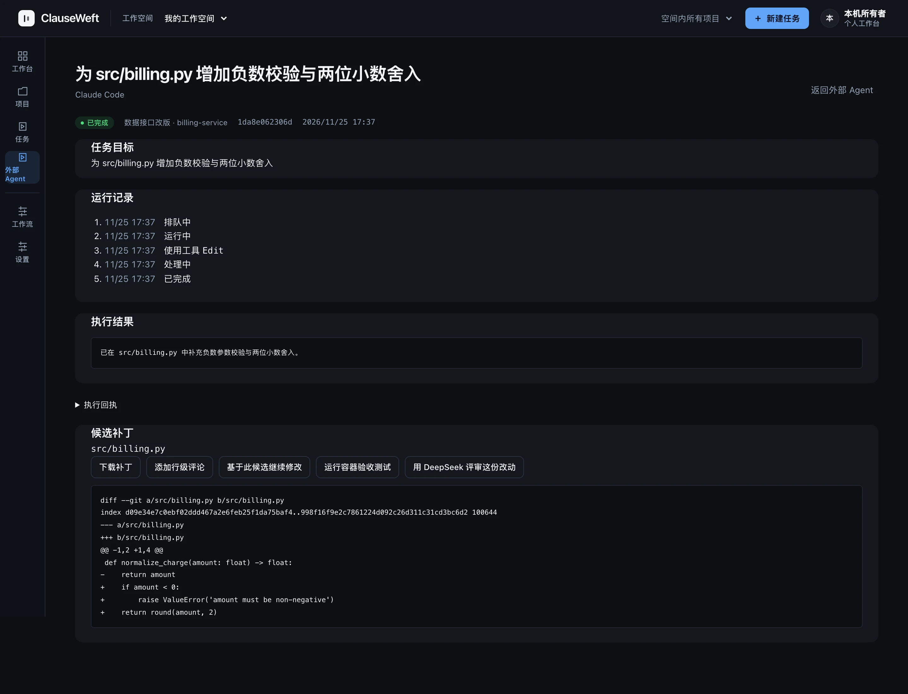

# ClauseWeft · 可控 AI Agent 编排与软件工程工作台

**本地优先、可控可验的 AI Agent 编排与软件工程工作台——整合多模型路由、多协议独立网关、受控 MCP 工具、容器隔离外部编码 Agent 与离线审计证明。**

[English](README.md) | 简体中文

[](#第一次使用)
[](#第一次使用)
[](LICENSE)

ClauseWeft 在你的本机保存项目、任务、长期记忆、执行证据、真实用量账本和候选补丁。核心运行时仅依赖 **Python 3.11+ 标准库**，采用单实例 SQLite 持久化与独立多协议网关。无论是直接问答与图片多模态分析、并行多分支拆解汇总、受控 MCP 与项目知识库检索，还是把 Git 仓库交给容器隔离的外部编码 CLI 修改、验收实测与行级评审，所有动作都在服务端权限、预算预留和可离线校验的哈希审计链内闭环。



*ClauseWeft 工作台实机运行界面：简洁专注的任务提交区、实时并行运行轨迹（`拆分任务 → 子任务 1 & 子任务 2 执行中 → 结果汇总`）、最近任务与外部 Agent 记录。另可查看[浅色外观](docs/images/workbench-light.webp)与[手机端布局](docs/images/workbench-mobile.webp)。*

---

## 核心能力

| 场景 | 任务方式 / 入口 | 平台能力 |
|---|---|---|
| **直接问答与多模态分析** | `single`（默认） | 支持附带本地 UTF-8 文本材料、受控 Base64 图片附件（`task.attachments`，自动追加 `vision` 能力筛选）、项目长期记忆与个人偏好；多轮追问超出窗口时自动生成可审计摘要压缩（`conversation_compaction`）。 |
| **并行拆解与汇总** | `complex` | 显式设置总预算；规划节点生成有界子任务分工，worker 并发执行各分支，全部分支成功后自动汇总，所有调用共用同一预算与审计图。 |
| **受控项目工具与 MCP 生态** | `mode=tool` | 内置项目需求检索/新建、SQLite FTS5 BM25 知识库检索（支持热更新），并支持接入可信配置的 `stdio` / Streamable `http` MCP 服务；支持单轮并行多工具调用与风险分级审批（`always` / `auto_read_only`）。 |
| **多协议独立模型网关** | `clauseweft-gateway` | 原生适配 **OpenAI Chat Completions**、**Ollama**、**Anthropic Messages** 与 **Gemini API**，支持 SSE 流式输出、原生工具调用、`response_format`、防 SSRF 的 Base64 多模态图片转换，以及 `cached_tokens` / `reasoning_tokens` 统计。 |
| **容器隔离外部编码 Agent** | **外部 Agent**（`#agents`） | 统一适配 **Claude Code**、**DeepSeek Harness**、**Codex**、**Gemini CLI**、**Kimi** 与 **OpenCode**；在非 root、只读根文件系统容器内处理白名单快照，支持固定镜像验收测试、有界自动修复循环（`max_fix_rounds`）、补丁行级评论与定向续接修改（`continue_from`）。 |
| **可验证代码交付与通用 SOP** | `workflow` / `sop` | 内置研发代码交付流程（需求基线审批、独立评审、受限 Git 补丁整合、固定 Docker 镜像实测与交付清单导出），以及支持组合 `model`、`agent`、`gate` 节点的版本冻结通用 SOP。 |

### 外部 Agent 实机执行与行级候选评审



*外部 Agent 实机运行详情：呈现状态事件流、执行摘要、可下载 Git 补丁、行级评审评论、候选测试与冻结候选只读评审入口。*

- **默认可审计**：派发意向、冻结单价、真实 token 回执、完整请求上下文、项目记忆、检查点与 SHA-256 哈希审计链同事务写入 SQLite，支持原始响应导出与独立离线核验（`clauseweft audit --input ...`）。
- **严格数据范围与预算边界**：`local_only` 任务、资料源、项目记忆与 MCP 服务永不路由至云端模型；费用按模型修订版本与币种分列，不伪造估算金额。
- **零第三方运行时核心**：Python 主程序无外部运行时依赖，供应商 API Key 严格隔离在独立网关或单次隔离容器环境中。

---

## 第一次使用

### 从源码启动

使用 **Python 3.11 或更高版本**，在仓库根目录执行：

```sh
PYTHONPATH=src python3.11 -m clauseweft --version
PYTHONPATH=src python3.11 -m clauseweft doctor
PYTHONPATH=src python3.11 -m clauseweft serve --config examples/workbench.json --state ~/.local/share/clauseweft
```

1. 打开终端显示的回环地址（默认 `http://127.0.0.1:8766/`），在「个人配对」输入启动时显示的本机访问令牌（后台进程从 `CLAUSEWEFT_CONSOLE_TOKEN` 读取）。已有团队账号可从「已有账号」入口登录。
2. 管理员在[独立网关](src/clauseweft/gateway/README.md)中配置自己的模型地址、协议、名称及凭据环境变量，通过「设置 → 模型配置」登记端点、币种和输入/输出单价并授权给工作空间。平台不预置商业模型或虚构价目。
3. 普通问答与多模态任务可从工作台直接提交。外部编码和评审从「外部 Agent」进入，需先按 `examples/agent-image` 的锁定依赖构建镜像，并配置执行器与允许使用的仓库。[外部 Agent 配置与操作](docs/12-个人工作台与外部Agent.md)

### 安装到独立虚拟环境

```sh
python3.11 -m venv .venv
. .venv/bin/activate
python -m pip install .
clauseweft --version
clauseweft doctor
clauseweft serve --config examples/workbench.json --state ~/.local/share/clauseweft
```

Windows PowerShell 使用 `.venv\Scripts\Activate.ps1` 激活环境。请将 `--state` 放在受信磁盘且位于被测 Git 仓库之外。[账号与数据归属](docs/10-工作空间与权限.md)

### 可复现的离线选模示例

无需启动服务或配置模型密钥，直接在本机验证路由规则：

```sh
PYTHONPATH=src python3.11 -m clauseweft route --input examples/route-demo.json
```

[示例输入](examples/route-demo.json)要求数据仅在本地处理（`data_scope: "local_only"`），因此会选中 `local-review`；将副本的 `task.data_scope` 改为 `public` 后，较低价的云端候选才会参与排序。

---

## 架构边界与演进

- **运行时与存储**：单实例 Python 3.11+ 模块化单体（17 个已登记模块），基于 SQLite、SQLite FTS5 与内容寻址工件存储。
- **权限边界**：个人所有者通过本机配对使用；共享团队部署通过 `admin`、`operator`、`viewer` 角色及工作空间/项目显式白名单在菜单、直接链接、SSE 事件流与 HTTP API 上统一由服务端核验。
- **升级方式**：停止原控制进程，将新版本进程的 `--state` 指向原状态目录即可无缝保留已有运行、需求版本、项目记忆、候选 SHA 与测试历史。
- **后续演进（P2）**：运行中待发提示队列、定时 Cron 自主运行、容器出口域名白名单代理、OpenTelemetry 追踪导出与受控 Git/PR 交付闭环，详见[后续演进与路线图](docs/13-后续演进与路线图.md)。

---

## 本地测试与核验

```sh
# 单元测试与本机集成回归
PYTHONPATH=src python3.11 -m unittest discover -s tests

# 启用本机固定 Docker 镜像的容器实测
CLAUSEWEFT_TEST_IMAGE="$(docker image inspect --format '{{.Id}}' python:3.11-slim)" \
  PYTHONPATH=src python3.11 -m unittest discover -s tests -v

# 分发入口与发布安全筛查
python3.11 scripts/check_distribution.py source
python3.11 scripts/check_release.py --checkout
```

完整 CI 矩阵（含锁定 Agent 镜像测试、Playwright 浏览器端到端验证及 npm 依赖审计）见 [.github/workflows/ci.yml](.github/workflows/ci.yml)。

---

## 开发文档

| 主题 | 文档 |
|---|---|
| 产品与使用 | [English README](README.md) · [任务与模型用量](docs/11-任务执行与模型用量.md) · [个人工作台与外部 Agent](docs/12-个人工作台与外部Agent.md) · [工作空间与权限](docs/10-工作空间与权限.md) · [产品需求](docs/01-产品需求.md) · [验收基线](docs/02-需求评审.md) · [后续演进与路线图](docs/13-后续演进与路线图.md) |
| 系统设计 | [概要设计](docs/04-概要设计.md) · [接口与事务](docs/05-详细设计.md) · [Agent 设计](docs/08-Agent设计.md) · [Harness 能力与审计](docs/09-Harness能力与审计.md) |
| 构建与运行 | [构建与运行](docs/06-构建与运行.md) · [网关协议](docs/07-Gateway详细设计.md) · [平台 API](src/clauseweft/api/README.md) · [独立网关说明](src/clauseweft/gateway/README.md) |
| 参与项目 | [贡献指南](CONTRIBUTING.md) · [编码 Agent 指南](AGENTS.md) · [安全报告指南](SECURITY.md) |

---

## 许可证

代码与随附文档采用 [MIT 许可证](LICENSE)。外部第三方 CLI 与上游模型供应商服务另须遵守各自的分发和使用条款。
