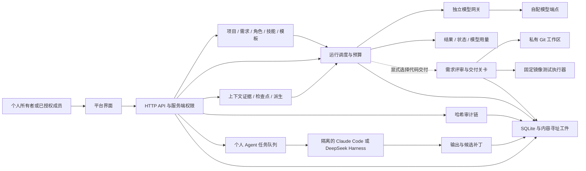

# ClauseWeft · 研发工作台概要设计

产品版本 0.0.1 · 设计基线 v0.5 · 2026-11-21 更新。平台从用户目标和内容生成可执行任务，自配模型通过路由和调度产生产物，按真实执行与用量形成证据。个人配对后默认项目已就绪，可直接提交任务并查看结果，高级协作按任务需要展开。[产品需求](01-产品需求.md) · [接口与事务](05-详细设计.md) · [Harness 能力与审计](09-Harness能力与审计.md)

## 系统结构

当前实现采用 Python 3.11+ 模块化单体，HTTP 服务与 worker 由同一控制进程管理，SQLite 保存业务数据、版本和账本，内容寻址存储保管模型答复及证据。独立网关仅负责将已选端点与消息交给配置的供应商。Git 变更和 Docker 测试在明确的执行边界内进行。

这套部署形态支持企业平台业务基础。高可用数据库、跨机器 worker 与组织目录接入按后续部署需求演进。一个状态目录仍由一个控制进程持有，避免重复恢复和重复执行。

## 业务对象与关联

| 对象 | 所有权与主要关系 |
|---|---|
| 成员与会话 | 服务端管理密码散列、会话、实例角色及显式工作空间和项目授权，审计记录操作身份 |
| 工作空间 | 隔开团队业务与示例内容，保存空间内角色、技能、模板和项目归属 |
| 项目 | 属于确定工作空间，需求与运行通过项目 ID 继承数据权限 |
| 需求 | 保存目标、正文、优先级和状态，关联执行运行 |
| SOP 模板 | 保存可编辑草稿与已发布节点快照，运行引用发布版本 |
| Agent 角色与技能 | 定义阶段、提示、模型及技能引用，正文和修订固定到节点输入 |
| 模型端点 | catalog 保管版本化能力、身份、价格、数据去向与网关绑定 |
| 运行与尝试 | 承载默认任务及按需协作，固定输入和计划，记录节点世代、租约、派发、版本价目与真实用量 |
| 评审与审批 | 固定需求版本、候选和证据，记录处理人及决定 |
| 候选与报告 | 绑定 Git SHA、树、需求基线、套件和镜像，形成交付清单 |
| 请求上下文 | 固定实际消息、输入来源、端点和限制，按内容摘要关联尝试 |
| 检查点与派生 | 固定旧运行状态，按来源复用模型成果，新预算及人工审批独立 |
| 审计 | 追加读写、拒绝、失败、配置和执行事实，关联内容版本，提供链校验和导出 |

需求中心的需求实体承担业务跟踪。仓库研发流程中的需求版本承担可执行基线，两者通过运行联系。需求标题与优先级更新不会自动改写已冻结的模型输入。修改执行内容应创建新的运行或通过现有版本修订入口明确使下游失效。

## 页面架构

顶部提供工作空间、账号及新建任务入口。工作台、项目与任务是一级导航。“协作”提供需求、角色、技能、SOP 与审批。“资源与管理”收纳模型、用量、团队与审计。窄屏可展开“导航”切换。菜单和操作按当前能力显示，工作台只汇总当前空间内获授权项目的任务。单任务详情先展示内容、模型、状态和结果，多步骤任务再呈现必要的步骤与产物关系。详细上下文、检查点和原始证据按需读取。切换空间或身份时清理原详情与缓存，未授权深链接显示权限反馈。

浏览器通过同一 HTTP API 完成业务。常规操作使用结构化控件，错误、空态和权限反馈与后端结果一致。自动更新保持运行状态可见，切换项目后刷新关联数据。统计从持久化运行和尝试计算，等待、失败、取消和费用未知分别表达。

## 模块边界

| 模块 | 负责内容 |
|---|---|
| api | HTTP、身份上下文、版本和幂等前置、平台页面、业务入口 |
| 平台业务层 | 成员会话、项目、需求、角色、技能、SOP 草稿与发布、总览 |
| catalog | 端点登记与版本、网关 ETag、模型身份和能力探测 |
| routing | 从冻结输入计算意图、候选、淘汰原因和排序依据 |
| workflow | 编译单任务、复杂任务的分工、仓库研发及发布 SOP 的依赖图，校验依赖及独立模型分配 |
| runs | 领取、派发、重试、取消、恢复、预算预留、实际 token 与派发版本价目结算 |
| usage | 按授权项目及模型版本统计实际调用、token、金额和缺失状态，币种分列 |
| requirements / reviews | 版本基线、独立意见、处置与签署决定 |
| workspace | 获准文件快照、路径受限补丁、私有索引整合和可重放导出 |
| testing | 冻结必测套件、固定镜像执行、证据核验 |
| evaluation | 冻结样本的规则回放、两侧执行、盲评与成本汇总 |
| storage | SQLite 事务、事件、内容寻址工件、读取校验 |
| harness | 请求证据的脱敏读取、稳定检查点与有来源的派生运行 |
| project_tools | 项目资料检索、需求查重与经审批的工具操作 |
| agent_runtime | Claude Code 与 DeepSeek Harness 的容器隔离执行、协议解析与输出过滤 |
| audit | 统一审计链、资源修订、旧记录迁移、完整性校验和导出 |
| gateway | 独立 HTTP 服务、供应商凭据和协议适配 |

## 运行模型

### 从源码定位一次任务

| 要修改的行为 | 源码入口 |
|---|---|
| 提交表单、查看进度和回执 | 修改 [任务表单](../src/clauseweft/api/web/scripts/task-form.js) 或 [运行详情](../src/clauseweft/api/web/scripts/run-records.js)。[脚本清单](../src/clauseweft/api/console_app.py) 和[样式清单](../src/clauseweft/api/console_styles.py) 按顺序组装工作台 |
| 核验请求、预算与项目权限 | [HTTP 应用](../src/clauseweft/api/application.py) 管理请求事务与幂等。[权限策略](../src/clauseweft/api/access_policy.py) 核验当前授权，[运行规划](../src/clauseweft/api/run_planning.py) 冻结输入并建立运行，[运行接口](../src/clauseweft/api/run_routes.py) 处理后续查询和操作 |
| 账号与工作空间 | [账号模块](../src/clauseweft/api/accounts.py) 管理凭据、会话和成员授权。[平台资源](../src/clauseweft/api/platform.py) 保存项目与 SOP，[资源校验](../src/clauseweft/api/resource_validation.py) 核对跨资源引用，[初始化](../src/clauseweft/api/platform_setup.py) 负责建表和旧数据迁移 |
| 领取、派发、结算模型调用 | 从 [Runs 入口](../src/clauseweft/runs/engine.py) 进入。派发事务保存上下文与预算预留，回执事务结算费用并更新执行图。[运行模块导航](../src/clauseweft/runs/README.md) |
| 提议并执行工具 | [工具决策](../src/clauseweft/project_tools/decisions.py) 定义模型可用的工具、参数和终止条件。[审批](../src/clauseweft/project_tools/approvals.py) 核对提议，执行已批准操作并写回回执。[资料源](../src/clauseweft/project_tools/references.py) 载入和检索项目资料 |
| 整合补丁、执行验收和查看工件 | [交付关卡](../src/clauseweft/api/delivery.py) 接收审批和返工请求，[后台作业](../src/clauseweft/api/delivery_jobs.py) 执行 Git 整合与隔离测试，[交付证据](../src/clauseweft/api/delivery_evidence.py) 读取和导出工件 |
| 评估与审计导出 | [评估接口](../src/clauseweft/api/evaluation_routes.py) 发起配对试验、读取执行结果并接收评分。[审计证据](../src/clauseweft/api/audit_evidence.py) 收集部署快照和导出材料 |

### 节点与数据流

文本单任务只有一个模型节点，默认使用 general 阶段，可选角色决定其提示、阶段、技能与绑定模型。复杂任务先生成分工，服务端从一份合法的规划回执创建并行分支和汇总依赖。两者通过同一运行服务领取工作、预留预算、派发和提交产物。[图编译](../src/clauseweft/workflow/README.md)

通用 SOP 从已发布的模型与人工关卡图创建运行。仓库研发可直接选择内置交付流程，提供登记仓库、基准、套件和预算。该图固定需求批准、受限补丁、整合、代码评审和必测关卡。

节点依赖就绪才可领取，人工关卡等待操作者处理。模型节点派发前重新计算完整消息的上下文与价格，检查当前授权及预算。独立评审组以模型身份去重。模型调用结束后，只有仍有效的节点世代才能发布产物，历史尝试和费用持续保留。

角色和技能在发布或启动时冻结到输入快照，本地技能继续收紧节点的数据范围。每次实际派发保管完整消息和来源，返工改变当前节点时，旧尝试仍能读取自己的原请求。检查点保管稳定运行状态，派生时按来源复用允许复用的模型成果，人工关卡和依赖授权的下游重新处理。

## 模型与用量

管理员在独立网关维护自己的模型连接与供应商凭据引用，在 catalog 登记能力、身份、数据范围和真实输入/输出价目，再将端点授权给工作空间。安装不登记可调用模型。普通选定模型的单任务可以省略手填预算，由服务端按模型币种、价格和请求上限生成有限的单次预算。复杂任务必须显式提交总预算。仓库交付在工作台要求填写预算，API 兼容省略字段的旧请求，按零额度检查每次派发。

派发时固定 endpoint_id、配置版本、模型身份和价格，回执归一化后保存实际输入、输出及合计 token。usage 从授权项目的实际尝试按模型版本和币种统计，价格变化不修改历史。配置模型没有调用时显示未调用；缺用量、非法用量、未知外部结果及待核对金额各有明确状态，不以估算 token 填补回执。平台计价与供应商账单通过具名对账关联。[用量口径](11-任务执行与模型用量.md)

## 一致性与治理

写请求的身份、业务前置和版本在服务端检查。业务状态、版本、事件、审计和幂等结果在对应事务中提交。派发前持久化意向与预算预留，结果未知的调用保持待核对。Git、网关和容器进程在短写事务外运行，提交结果时再检查当前版本与世代。

读取、拒绝和失败也是独立的审计事实，失败写入保持其业务状态回滚。后台运行事件进入统一记录链，并通过运行、节点、尝试和内容摘要关联证据。业务正文修订与配置快照保留来源。审计链及资源修订表按追加方式保存，验证和导出使用固定链头，运维数据库写权限属于受信边界。[完整审计范围](09-Harness能力与审计.md)

admin 管理全实例，operator 在显式获授权空间和项目内完成业务配置、执行和审批，viewer 读取获授权项目。非管理员的空间和项目允许列表同时生效，空授权无业务数据，实例管理和完整审计仅管理员可用。列表在分页前过滤，单对象和所有运行子资源复核归属，幂等命中仍检查当前授权。资源之间的引用必须在同一工作空间。[权限矩阵](10-工作空间与权限.md)

首次安装仅初始化一次空的默认团队空间及独立示例空间。新示例只有一个项目及一条待配置模型的单任务，无需求、模板、审批、真实模型和容器执行。旧安装已有的示例按其历史保留。未归属空间的旧资源归入默认团队空间并保留修订及执行历史；原本没有显式授权的非管理员由管理员分配范围，已有允许列表继续保留。会话和访问令牌保管、部署及报告流程见[安全说明](../SECURITY.md)。

## 扩展方向

组织身份与 SSO、每项目独立角色及自定义授权、跨实例 worker、高可用数据库、代码托管交付适配器、脚本和子 SOP、编码 CLI、可执行插件及 MCP 接入均通过明确接口扩展。当前技能是受版本管理的文本指令。每项扩展须保留已冻结输入、版本审批、预算、真实执行和审计证据的契约，并在目标部署环境建立验收记录。
