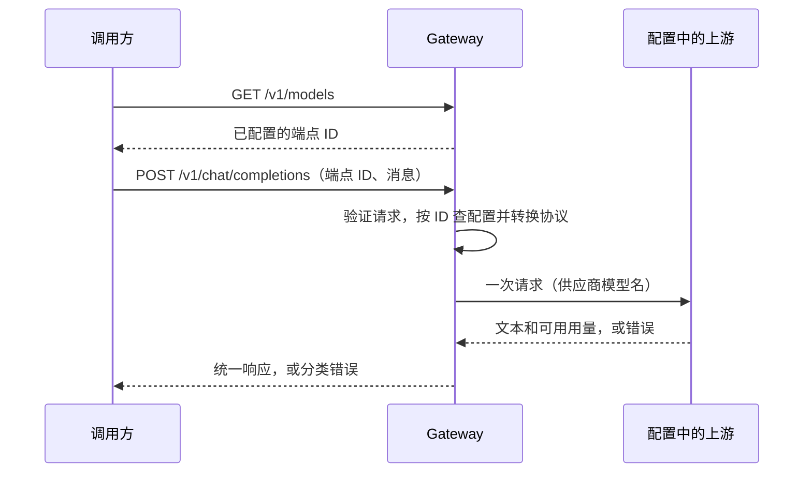

# 模型 Gateway 详细设计

设计基线 v1.0 · 2026-11-15 · 首版面向单机或受控容器网络中的可信调用方。Gateway 是独立的 Python 3.11+ HTTP 进程。它把已选定的端点 ID 转为一次模型调用，向调用方提供统一的文本对话接口。平台怎样选择端点、批准需求及预留费用，见[平台概要设计](04-概要设计.md)和[平台详细设计](05-详细设计.md)。

**实现状态。** 仓库已包含独立服务入口、配置加载器、HTTP 处理器、两种上游适配器和专用 Dockerfile。三条 HTTP 路径由该服务提供。平台 worker 通过此网关派发任务，并在平台数据库中记录预算和交接。独立服务也可直接连接符合本文文本协议的本地测试端点。[服务源码](../src/clauseweft/gateway/server.py) · [协议适配器](../src/clauseweft/gateway/providers.py) · [网关镜像](../src/clauseweft/gateway/Dockerfile)

## 1. 谁选择模型，谁发请求

| 入口 | 谁决定用哪个模型 | 谁会收到请求 | 这一步改变什么 |
|---|---|---|---|
| 本地 `clauseweft route` | 离线路由器读取任务、能力、预算快照，输出 `selected_endpoint` 等结果 | 无网络调用 | 得到可复算的预览结果 |
| 独立 Gateway `POST /v1/chat/completions` | 客户端把选定端点 ID 填入 `model` | Gateway 配置中与该 ID 绑定的上游 | 最多一次实际请求，上游可能计费 |
| 平台派发流程 | routing 建议，runs 复核当前数据许可、模型身份及账本 | worker 将当前尝试发给获准 Gateway，model 指定已核实的端点别名 | 持久化派发意向、预留、回执及产物；失败回退产生新的尝试 |

独立部署只需要 Gateway 代码、配置文件及可访问的上游。数据库、路由 CLI、工作台和仓库沙箱都可以缺席。客户端也可以直接使用 Gateway；这条路径仅受 Gateway 的访问与资源限制约束，平台的预算和数据策略仅在经过平台派发时生效。



## 2. 端点配置与变更

管理员提供 JSON 文件。下例建立一个指向本机 Ollama 的逻辑端点；`model` 需要与实际安装的模型名一致。部署者可再配置一个兼容 Chat Completions 的服务，并用不同 ID 区分。

```json
{
  "endpoints": [
    {
      "id": "local-review",
      "model": "qwen3:8b",
      "protocol": "ollama",
      "base_url": "http://127.0.0.1:11434"
    }
  ]
}
```

| 字段 | 归属与约束 | 用途 |
|---|---|---|
| `endpoints[].id` | 部署者给出的唯一逻辑名 | 对话请求用它选择端点，也可和平台选出的 endpoint_id 对齐 |
| `endpoints[].model` | 上游实际识别的模型标识 | 向上游发送该名称；两个不同 ID 可能落到同一底层模型 |
| `endpoints[].protocol` | `ollama` 或 `chat_completions` | 决定协议路径及请求和响应的映射 |
| `endpoints[].base_url` | 受信的上游基础地址 | 来自服务启动配置，不能由对话请求指定或覆盖 |
| `endpoints[].api_key_env` | 可选，值为环境变量名称 | 只向该端点注入供应商凭据；配置文件不含密钥值 |
| `endpoints[].allow_insecure_http` | 受限私网的显式例外 | 无上游密钥时，用于管理员指定的私网 IP 或 `host.docker.internal`；需明确允许将任务内容传至该地址 |
| `token_env` | 可选，Gateway 入站 Bearer 凭据的环境变量名 | 与上游密钥分别配置。监听非回环地址时必须配置入站凭据 |
| `timeout_seconds`、`max_concurrency` | 进程级上游超时与同时生成的请求数 | 管理员按上游容量设置；这是执行资源限制，费用控制仍由调用方负责 |
| `max_tokens`、`endpoints[].max_tokens` | 进程级上限与更小或相等的端点级上限 | 未配置时全局为 4096，端点继承全局值；用于限制单次生成 |
| `max_request_bytes`、`max_response_bytes` | 默认分别 1 MiB、4 MiB | 限制入站请求体和上游响应体，防止单次请求占用过多内存 |

启动加载最多 1 MiB 的配置，允许 1–256 个端点；未知字段、重复 JSON 键和重复端点 ID 会令加载失败。默认上游超时 60 秒、最多 4 个同时处理的生成请求。普通外部端点必须使用 HTTPS；配置 URL 禁止内嵌凭据、查询串与片段。默认入站令牌环境变量为 `CLAUSEWEFT_GATEWAY_TOKEN`。[配置校验实现](../src/clauseweft/gateway/config.py)

修改配置后重启加载。配置版本为原始 JSON 文件字节的 SHA-256，空白变化也会产生新版本，环境变量值不会进入摘要。`GET /v1/models` 返回此部署的 `ETag`。独立客户端可把该值原样放入对话请求的 `If-Match`；不匹配时网关返回 412，尚未发上游请求。完整平台的 catalog 应在核实端点身份和数据去向时保存 ETag，worker 每次派发均发送该标签。这样旧审批不会被自动套用到改指云端的别名。对同一 URL 后面的供应商动态代理、模型替换及凭据轮换仍需分别核实，配置文件摘要不能证明远端的实际行为。

## 3. HTTP 契约与协议映射

| 接口 | 请求和返回 | 对上游的影响 |
|---|---|---|
| `GET /healthz` | 返回本进程的存活状态 | 不探测实际模型，不产生推理费用 |
| `GET /v1/models` | 返回已配置端点的 ID，供请求中的 `model` 使用 | 列举内存目录，没有验证上游是否装有模型或余量充足 |
| `POST /v1/chat/completions` | UTF-8 JSON，指定单个 `model`、`messages`；成功响应从 `choices[0].message.content` 读取文本 | 按指定端点发出一次非流式生成请求 |

```json
{
  "model": "local-review",
  "messages": [
    {"role": "system", "content": "你负责需求评审。"},
    {"role": "user", "content": "列出 CSV 导出权限条款中缺失的验收条件。"}
  ],
  "stream": false,
  "max_tokens": 128
}
```

对话请求只接受上述四个顶层字段；`messages` 必须包含 1–256 项，每项只有 `role` 和非空文本 `content`，角色可取 `system/user/assistant`。省略 `max_tokens` 时使用该端点上限。显式超过上限默认返回 400。平台 worker 发送 `X-ClauseWeft-Token-Limit: clamp` 请求头，网关将本次请求的上限收紧至端点允许值，再调用一次模型。目录 `GET /v1/models` 在每个条目中返回 `max_output_tokens`，生成回执在 `gateway_metadata.max_output_tokens` 中记录本次实际发送的上限。提供 `Content-Type: application/json` 和单一有效的 `Content-Length`，块传输和重复 JSON 键会被拒绝。在要求 JSON 决策的节点，worker 发送 `X-ClauseWeft-Output-Format: json`。Ollama 适配器据此传入原生 `format: "json"`，Chat Completions 继续使用文本请求。网关返回的内容仍须通过平台的决策结构和参数校验才能用于执行。

**协议适配。** `ollama` 访问其原生 `/api/chat`，显式关闭流式输出，按配置替换模型名，并把原生 `message.content` 转成 `choices[0].message.content`。`chat_completions` 访问兼容协议的对话路径，以对端要求的模型名和文本消息构造请求。两类适配器只消费支持的字段，不接受客户端传入的供应商凭据、请求头、目标 URL 或返回地址。原生接口和兼容接口在上游可能支持更多功能，首版 Gateway 的能力以本文和代码为准。[Ollama 原生 Chat](https://docs.ollama.com/api/chat) · [Ollama 的兼容接口说明](https://docs.ollama.com/api/openai-compatibility)

**用量语义。** Ollama 原生返回的 `prompt_eval_count` 和 `eval_count` 分别代表输入和生成的 token 数，兼容接口可直接返回标准用量字段。用户提交的 token 上限是请求约束，回执用量是观测值，两者不能互换。模型调用完成不等于账单已结算；平台账本区分供应商回执、金额预留、按派发价目计算的金额及待核对款项。[平台用量口径](11-任务执行与模型用量.md)[Ollama Chat 响应格式](https://docs.ollama.com/api/chat)

| 适配规则 | `ollama` | `chat_completions` |
|---|---|---|
| 目标地址 | 在 base_url 路径后追加 `/api/chat`，常用 base_url 为服务根地址 | 在 base_url 路径后追加 `/chat/completions`；若服务路径以 `/v1` 开头，应在 base_url 中包含 `/v1` |
| 限制生成长度 | `options.num_predict` | `max_tokens`，因此上游须支持该参数 |
| 成功条件 | `done=true`，有效的 assistant 文本消息 | 恰好一条 choice、assistant 文本消息、受支持的 finish_reason |
| 归一化结果 | 将 `done_reason` 归入 finish_reason，缺省为 stop | 保留 stop、length 或 content_filter；工具调用和格式不完整归上游响应错误 |

成功响应的 `model` 是网关端点 ID，`id` 由网关生成。输入、输出与合计 token 数完整且合法时返回 `usage`；否则省略用量，调用方应记为未知。可选的 `gateway_metadata` 收录上游实际回传且符合格式要求的标识，包括 `upstream_model`、`upstream_request_id` 和兼容接口的 `upstream_completion_id`。这些字段缺失时逐项省略，不从配置猜测；可用于后续核查，但网关生成的 ID 不能用作供应商账单号。出站 HTTP(S) 直连，拒绝跟随重定向或自动重试；入站令牌不转发给上游。

平台只发布 `finish_reason=stop` 且包含非空正文的结果。`length` 表示答复被截断，`content_filter` 表示服务端过滤了答复。两者和空答复都会让该节点进入待处理状态。调用记录保留结束原因、实际输出上限、返回文本和回执，完整用量按冻结的价目结算。用量缺失时保留预留，须先对账再重试。

## 4. 错误如何影响一次尝试

健康检查公开，只返回 `{"status":"ok"}`。目录与对话走相同入站鉴权，启用认证时使用 `Authorization: Bearer <网关令牌>`。网关自行生成 `X-Request-ID` 以关联一次请求；错误 JSON 为 `{"error":{"code":"revision_mismatch","message":"配置版本已改变，请重新获取模型目录"},"request_id":"…"}`。客户端应同时读取状态码和 `error.code`，不要依赖错误文案或把 request_id 用作幂等键。

| 观察到的情况 | 独立调用方如何解释 | 平台如何处理 |
|---|---|---|
| 端点 ID 未登记、请求格式不支持、入站认证失败 | 输入或授权需要修正，上游不应收到请求 | 保留失败原因，修订或重配后建立新的有效尝试 |
| 上游拒绝凭据或限流 | Gateway 没有切到其他模型 | 按失败类别和当前策略判断是否可换端点或延迟重试 |
| 上游响应无法解析、运行中断、客户端断开或读超时 | 即便未收到正文，上游也可能已执行或计费 | 保留预留并标待核对；排重、查供应商回执后再决定是否授权重发 |
| 同一 JSON 再次 POST | 第二个独立请求，有再次计费的可能 | 应用层维护 attempt_id、派发意向和重试预算，不能把重复 POST 当作读取旧结果 |

网关没有持久任务表、账本或跨进程结果缓存。多次独立 HTTP 请求可以分别承载工作流分支；隔离输入、不同模型数、分支汇合、冲突裁决和取消后的迟到结果处理都由上层工作流定义。

并发限制在读取对话请求体之前生效；`429 concurrency_limit` 表示网关没有空闲生成名额。HTTP 连接另设 `max_concurrency+8` 的上限，满额可返回 `503 server_busy`。这两种本地拒绝均未访问上游。缺少有效令牌为 401，未知端点为 `404 model_not_found`，版本变化为 `412 revision_mismatch`，请求过大为 413。无长度或媒体类型不对分别返回 411 和 415。[HTTP 处理实现](../src/clauseweft/gateway/server.py)

上游返回 429 时用 `429 upstream_rate_limited`；上游 401/403 映射 `502 upstream_authentication_failed`。上游密钥引用缺失或格式无效为 `503 upstream_credentials_unavailable`，请求尚未发出。超时为 `504 upstream_timeout`；不完整或无效的上游响应为 502。网关返回固定的错误字段，省略供应商错误正文、密钥和推理输入。[适配器错误映射](../src/clauseweft/gateway/providers.py)

## 5. 独立运行与验证

源码入口为 `python -m clauseweft.gateway --config FILE --host 127.0.0.1 --port 8765`。在同一个容器里，回环地址只指向该容器；配置上游时使用容器能够访问的受信地址。网关镜像、端口映射和本机启动步骤见[独立部署说明](../src/clauseweft/gateway/README.md)。使用标准库 HTTP 服务的首版适用于本机或受控网络；若扩大访问范围，需明确 TLS 终止、调用方身份、流量和连接限制以及配置轮换责任。[Python 3.11 HTTP 服务说明](https://docs.python.org/3.11/library/http.server.html)

现有集成测试使用可记录调用次数的本地 HTTP 替身，覆盖目录版本不匹配时没有外发、两种适配器的消息与凭据映射、无效请求被拒、重定向不跟随和并发满时健康检查仍可用。测试环境可以无模型、无真实供应商凭据。真实端点的模型安装状态、生成质量、供应商结算及容量仍须在目标部署中验收。[网关集成测试](../tests/test_gateway.py)

## 6. 交付基线与验收

独立运行须满足下列可观察行为。实现与测试以本节、上面的 HTTP 契约及示例配置为准。网关的配置由部署者维护，更新通过校验配置、替换文件、重启进程完成。平台端核实新 ETag 后再恢复派发。未来新增流式输出或工具调用时须单列协议及验收要求。

| 编号 | 操作 | 通过条件 |
|---|---|---|
| G01 单独分发 | 只保留 gateway 目录，在其父目录启动；分别验证源码、独立镜像、本机编译包 | 可以监听回环端口并读取模型列表；测试全程无需数据库、工作台或平台 worker |
| G02 配置预检 | 部署前执行 `--config FILE --check-config` | 仅检查本地配置结构与地址规则。成功退出 0，向 stdout 输出 JSON 的 `status="valid"`、`revision`、`endpoint_count`；配置无效退出 2。即使尚未注入运行时令牌也能预检。此模式不监听端口、不探测上游、不输出模型消息、凭据或地址。此处 revision 与随后启动同一文件所得 ETag（去引号）的值一致 |
| G03 跨协议调用 | 分别请求 Ollama 和 Chat Completions 测试端点 | 每次只有一个上游请求；别名、模型、输出上限与协议字段正确；回执含文本和可得的标识；合法用量按协议映射，未提供或非法的用量省略并由上层记作未知；入站令牌不会传给上游 |
| G04 准入与版本 | 缺少必需令牌、要求不支持的流式调用、传未登记端点或过时 If-Match | 网关返回相应错误，上游计数不增加；显式配置入站令牌却缺失时，服务启动失败 |
| G05 并发与异常 | 单推理名额占满时发第二个请求；上游返回重定向 | 新推理返回 429，健康接口仍可用；上游重定向不触发第二次调用。客户端凭错误分类决定后续行为 |

**本轮验收记录（2026-11-15）**：同一套 8 项网关集成测试分别在 Python 源码、Linux arm64 独立 Docker 镜像和 macOS arm64 Nuitka 原生程序上通过。容器测试禁用外网，只在回环接口启动网关与模拟上游。全仓测试另含 5 项离线路由用例，共 13 项通过。测试验证了真实 HTTP 往返、两种协议的字段转换、配置摘要、鉴权及并发限制；用户实际模型的可用性、质量与账单应在接入端点后另行核验。[可重复执行的测试](../tests/test_gateway.py)
