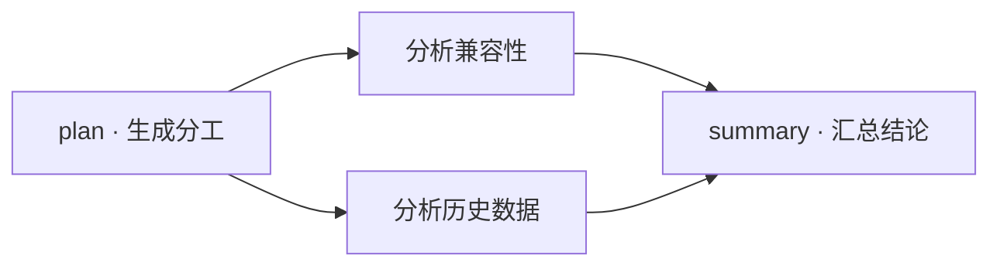
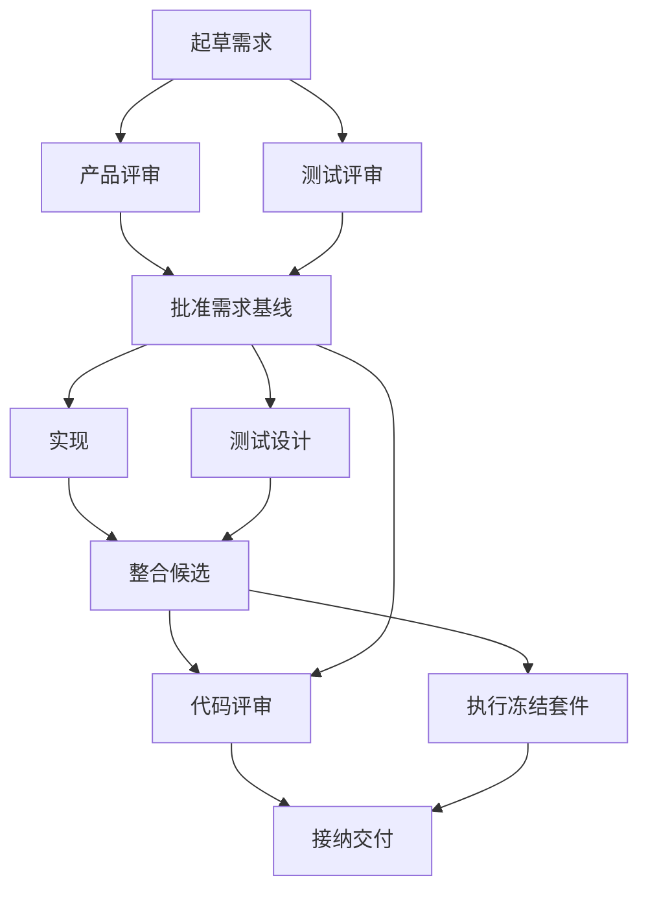

# ClauseWeft · 平台 Agent 与 SOP 设计

独立的外部 Agent 任务可从固定 Git 基准取得代码改动和只读评审，使用供应商 CLI 的运行协议并保存结果。[外部执行器](12-个人工作台与外部Agent.md)

一次 `single` 运行处理一个目标，`complex` 运行可为同一目标生成一组临时分工。需要审批或仓库实测时，使用已发布的团队 SOP 或内置 `workflow`。每种方式把实际输入、节点产物、模型身份、用量和人工决定保存在所属项目中。[平台概要](04-概要设计.md) · [源码对照](03-竞品调研.md) · [Harness 与审计](09-Harness能力与审计.md)

## 临时分工与汇总

以评估一项接口变更为例。提交者把现状和拟议改动写进任务正文，设置运行总预算，选择 `complex`。规划模型可分别安排客户端兼容性与历史数据迁移两项分析，服务端校验其 JSON 答复后扩展执行图。



规划答复的格式为 `{"subtasks":["分析旧客户端在字段缺失时的行为","分析存量数据在新字段下的迁移条件"]}`，接受 2 至 8 项分工。节点可同时领取，实际并行度取决于运行的 `max_concurrency`、worker 数量与可用预算。各分支收到原任务和自己的分工，汇总读取所有分支的成果。分工之间可以使用同一合格模型，仓库流程的独立模型要求由其专用评审分组执行。

各次实际派发分别记录请求工件、节点世代、模型身份、预算预留和回执。无效计划的原始答复留在尝试记录，节点以 `invalid_complex_plan` 等待处理，可恢复运行并重新规划。必需分支失败时，汇总等待其成功。已有有效分工后，若要改换计划，需新建复杂任务。稳定检查点可保存当前图，检查点派生适用于单任务与通用 SOP。文本分工产出的结论保留为模型答复，代码交付的证据来自下文的仓库流程。

## 角色与模型资源

角色保存名称、职责说明、任务阶段、提示、技能引用和可选端点绑定。模型资源保存身份、协议能力、上下文、价格和数据去向，实际推理由独立网关完成。角色可固定已登记端点，也可让路由根据当前任务内容和约束选择。

| 专业角色 | 主要职责 | 当前默认阶段 |
|---|---|---|
| 产品分析师 | 澄清目标、用户行为、边界和客观验收条件 | requirements |
| 独立评审员 | 检查歧义、遗漏与风险，提供位置和依据 | review |
| 研发工程师 | 根据批准的需求和获准文件范围提出变更 | code |
| 测试工程师 | 设计正常路径、异常路径和边界条件的用例 | test |

这些角色由团队按需创建。单任务可提交顶层 `role_id`，服务端读取与项目同一工作空间的角色，在启动时固定其提示、阶段、端点绑定及技能版本。用户目标保存在任务正文中，模型请求区分角色指令与用户消息。SOP 在模板发布时冻结所引用角色的定义。两种方式都在派发时检查当前技能状态、数据范围和端点授权。

## 技能与实际请求

技能是受版本管理的文本指令，可以保存评审清单、团队编码约定、测试要求或业务术语。角色通过 skill_ids 引用技能，单任务也可以显式选择。引用的任一技能当前要求仅本地处理时，整个运行只在合格本地端点中选择，节点还要保留冻结技能原有的数据边界，固定模型和回退同样受约束。

一次模型请求由角色提示、技能正文、任务目标、当前返工意见和上游产物组成。派发前保存完整请求工件和摘要，关联本次运行、节点、世代、尝试、输入引用和目标端点。历史节点返工或角色变更后，审阅者仍可读取当时实际使用的请求。

上下文入口提供脱敏消息和来源，分别呈现原始工件与展示视图的摘要。旧版尝试没有保存完整请求时显示证据缺失，便于确定可复验范围。模型答复、用量和外部回执按实际收到的数据记录。

## 通用 SOP

通用 SOP 适用于文档、方案和评审等任务。当前提供模型与人工关卡两类节点，节点可以有多个前置依赖。编译时检查 ID、悬空依赖和环，依赖完成后才可运行。


模型节点消费原始任务及其直接上游工件，执行本角色提示。人工关卡汇集前序产物，等待有权限的操作者给出决定。节点的运行状态、输入摘要、尝试、端点和输出独立保管。更改草稿或发布新版 SOP 后，新运行使用新版本，已有执行继续引用原版本。

技能正文已作为显式上下文输入。Claude Code 和 DeepSeek Harness 通过独立任务执行。SOP 中的脚本、子 SOP、编码 CLI 节点、可执行插件和 MCP 仍属后续适配。新增节点类型需要定义输入、真实执行证据、失败与重试语义、服务端授权边界及审计关联。

## 仓库研发 SOP

用户可直接选择内置代码交付并提供登记仓库、基准、套件与预算，无需先创建角色或发布自定义 SOP。仓库研发使用具有领域校验的交付图，保留需求批准、独立评审、受限补丁、候选实测和最终接纳的门槛。该模板的必需依赖固定，团队通过角色提示和模型绑定适配职责。通用 SOP 可编辑模型及人工关卡的依赖图。



| 节点 | 输入与输出 |
|---|---|
| draft | 任务目标与起草提示，输出带稳定 ID 和验收条件的 clauses |
| review-product / review-test | 同一份需求草稿，分别输出结构化 findings，提交前互不读取对方结果 |
| approve-spec | 当前需求版本、必需评审和阻断意见，批准后形成下游可消费基线 |
| code / test-design | 已批准条款、版本、获准文件快照和写入范围，分别输出补丁 |
| integrate | 操作者选择的互补工作包，按顺序在私有 Git 索引中整合为唯一候选 |
| code-review | 当前需求基线和实际候选补丁，输出绑定候选的 findings |
| execute-tests | 当前候选和服务端冻结套件，输出真实容器执行报告 |
| accept | 有效代码评审与必测证据，经操作者接纳后固定交付清单 |

仓库模式的角色提示需要保留服务端约定的输出格式。通用角色职责可以在发布模板中增强提示，领域工件仍由后端验证。格式错误保留原始答复并进入待处理状态。

## 产物协议

需求草稿使用 clauses 数组，条款包含 id、text 和 acceptance。条款 ID 可被可信必测用例的 clause_id 引用。

```json
{"clauses":[{"id":"CSV-01","text":"普通成员请求导出时应被拒绝","acceptance":"输入 member 时输出 denied"}]}
```

评审返回 findings，每条意见包含 location、severity、example、suggestion 和 evidence。severity 取 blocker、major、minor、info。没有意见时返回空数组，这仍是一份明确的评审提交。

```json
{"findings":[{"location":"CSV-01","severity":"major","example":"始终拒绝所有人也能满足当前用例","suggestion":"补充管理员成功导出条款","evidence":"当前验收只定义普通成员行为"}]}
```

编码或测试设计返回 patch 文本。服务端检查路径授权、大小和内容，在固定基准上应用。实际补丁、来源工作包、候选 SHA 和代码树散列随后保存在整合记录中。

```json
{"patch":"diff --git a/app.py b/app.py\n--- a/app.py\n+++ b/app.py\n@@ -1 +1 @@\n-print('base')\n+print('denied' if input() == 'member' else 'base')\n"}
```

此示例仅说明补丁格式。真实交付是否满足管理员成功、普通成员被拒绝和空结果行为，由需求、独立代码评审及服务端必测套件共同确定。

## 独立性、路由和费用

需求双评审和实现/测试设计组分别要求不同、已核实的底层 model_identity。同模型别名不能充当两个独立角色。分配时综合各路候选和已占用身份，约束较紧的分支可以使用唯一可选模型，灵活分支使用另一合格模型。

模型路由在每次实际派发前重查完整消息、数据范围、端点状态、网关版本、上下文、能力与预算。角色固定模型仍受这些条件限制。预览及派发记录显示候选、淘汰原因、原首选、实际端点和发生的回退或分组约束。

预算按每个实际尝试预留，只有派发意向和预留已提交的 worker 才能调用网关。有效用量按登记价格结算，供应商收费未知时维持待核对。取消或输入变更封闭当前产物发布，迟到答复仍可作为历史和账务依据。

## 人工接手

审批中心展示需要人工判断的关卡，操作者进入需求、产物、差异和实测记录后提交决定及依据。旧版本审批不能批准新稿，旧候选的通过报告不能放行新候选。

| 事件 | 接手动作 |
|---|---|
| 模型无候选或固定端点失败 | 查看候选原因，修正资源配置、预算或任务约束后恢复 |
| 草稿或评审格式无效 | 读取原始答复，修订条款或重跑对应评审 |
| 需求基线变化 | 在新版本重新评审和批准，重做受影响下游 |
| 补丁冲突 | 比较保留的工作包，选择顺序或提交冲突解决稿 |
| 实测失败、缺项或环境变化 | 修复相关工作包，重新整合并在当前环境实测 |
| 进程中断或外部结果未知 | 查看尝试与账单，完成费用对账再恢复 |
| 已取消 | 保留历史，继续工作时创建新运行 |

## 检查点与有来源的派生

运行没有 leased、dispatched、uncertain 节点，也没有排队或执行中的整合与测试任务时，可以保存具名检查点。检查点固定运行计划、输入、节点状态和成果，记录创建者、源运行版本及保存说明。

单任务和通用 SOP 的检查点可派生为独立运行，须提供新任务名称、依据和独立预算。成功模型节点只有在其全部前置均为可继承模型结果时才能复用，记录原运行、检查点、节点、世代、尝试和产物。人工关卡及其下游重新处理。当前授权、技能状态、数据范围、模型身份、端点和新预算继续在实际派发前校验。

仓库交付沿用需求修订、工作包返工与重新实测的入口。新运行不会凭旧审批或旧候选测试取得交付授权。原运行和原费用记录保持独立，派生关联可以从审计及节点来源继续追溯。

## 审计中的 Agent 事实

角色和技能修改、模板发布、请求组装、派发、结果、暂停恢复、取消、对账和人工决定均进入平台审计。后台执行事件以系统身份写入，创建者及人工决定人通过关联字段保留。模型成功产物、错误、结果未知和迟到回执分别记录，历史不会因界面重跑而消失。

审计记录绑定内容修订及摘要，链校验与导出供独立复算。查看上下文、产物与审计的访问也记录当前身份和结果，认证秘密不进入审计正文。自动脱敏匹配范围及数据库管理者的受信边界见[审计契约](09-Harness能力与审计.md)。

## 扩展时的验证

新增角色或技能先定义最小输入、提示、输出和失败动作，再确定可用模型和数据边界。新增执行器需要落实真实执行、隔离、用量、租约、回执和审计规范。发布变更后验证旧快照可读取，当前身份与预算重新检查，迟到回执无法覆盖新世代。检查点派生还需验证新预算与人工授权边界。测试入口和端到端记录见[构建与运行](06-构建与运行.md)。
