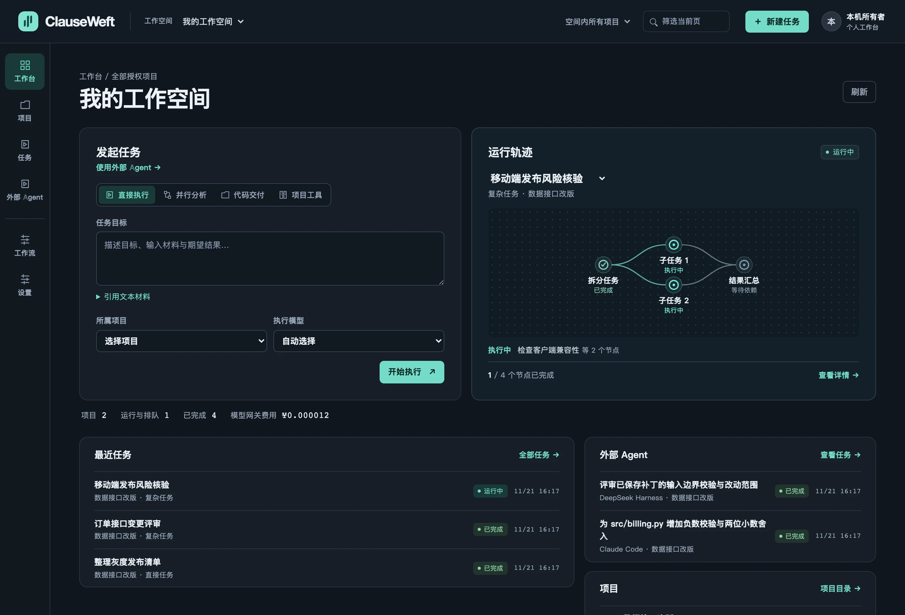

# ClauseWeft · 任务执行与模型用量

一个项目可以同时容纳直接答复的文本任务、需要分工汇总的任务，以及需要评审和实测的仓库交付。三者共用工作空间的模型授权和账本。本文以接口变更影响分析为例，说明如何提交任务并核对结果。[产品范围](01-产品需求.md) · [服务接口](../src/clauseweft/api/README.md) · [数据权限](10-工作空间与权限.md)

## 首次准备

管理员在独立网关配置自己的模型地址、实际模型名称和供应商凭据引用，再在平台“模型配置”登记端点。网关负责访问供应商，平台负责模型选择、任务、权限及用量。平台安装不会替团队开通模型、写入可调用的演示端点或预置价格。具体连接步骤见[模型网关](../src/clauseweft/gateway/README.md)。

登记时核对模型身份、网关别名及配置版本、可处理的数据范围、上下文上限和输入/输出单价。单价使用实际服务的币种和计费口径。确认免费时可明确填写零价，未知价格不填作免费。管理员在团队设置把端点授权给业务工作空间，普通成员只能选择该空间允许的模型。

团队工作空间初始没有业务数据。管理员创建成员并分配工作空间及项目，操作者也可以在已获授权的空间创建自己负责的项目。只读成员查看已授权项目的任务与结果。独立的示例空间在新安装时仅有一个项目和一条待配置模型的单任务，不生成需求、SOP、审批、推理结果或容器报告。旧安装的示例和历史继续保留，不因升级重置。

## 找到工作空间和项目

在页面顶部选择团队工作空间。点击 ClauseWeft 标志可回到工作台，点击右上账号可查看身份或退出。手机上点“导航”，即可选择页面、切换项目范围或筛选当前页。

| 入口 | 可执行的工作 |
|---|---|
| 工作台、项目、任务 | 从工作台提交目标或打开最近任务。在项目目录选择项目范围，到任务记录按状态筛选并打开成果 |
| 协作 | 进入需求看板、SOP 模板、Agent 角色、技能库或审批中心 |
| 资源与管理 | 按账号权限查看模型配置、模型用量、审计日志与团队设置 |

## 提交任务和读取结果

在工作台的“发起任务”填写要处理的原文或目标，选好所属项目和执行模型，点“开始执行”。普通单任务默认使用通用阶段，不需要先建立独立需求、角色或模板，也没有必经的人工审批。任务保留输入内容、所用模型、执行状态和产物；失败或等待配置时显示具体原因。

结果页先展示可读的内容和产物。执行过程、实际请求、检查点和详细证据按需读取，仍能定位同一运行、节点、尝试和模型版本。普通单任务的处理状态不等同于代码交付已验收，模型答复和真实测试报告分别保留其证据含义。

**引用本地文本。** 在任务输入框下展开「引用文本材料」，选择 UTF-8 编码的 Markdown、CSV、日志或其他纯文本。每次任务最多附 4 份，正文合计最多 64 KiB。展开文件名可核对全文，提交前可逐份移除。浏览器仅读取你选中的文件。预览路由或提交任务时，文件名和正文进入当前项目的请求。运行时材料随原始目标发送给各模型节点，遵循所选工作空间的数据去向、模型上下文和预算限制。

例如把 `amount 以整数分返回，旧客户端忽略未知字段。` 保存为 `接口说明.md`，在直接任务中引用它，输入「根据材料解释增加 currency 字段的影响」。在结果页展开「引用材料」可回看输入，在「请求上下文」可核对发送给模型的消息。点击「复制结果」可复用直接答复或并行任务的汇总结论，「下载文本」可把同一结果保存为 UTF-8 的 `.txt` 文件。

API 客户端直接传内容。上例的任务对象可写为 `{"text":"根据材料解释增加 currency 字段的影响","materials":[{"name":"接口说明.md","text":"amount 以整数分返回，旧客户端忽略未知字段。"}]}`。服务端把目标和每份材料保存在同次运行中，分别作为用户消息派发。

普通任务可省略手填预算。服务端按当前模型的币种、输入估计和输出上限计算有限的单次执行上限，预览标明预算来源。自动候选有多种合格币种时，选择一个模型或在高级设置中显式指定币种和额度。该上限用于预算检查和预留，最终金额仍根据实际回执或具名对账确定。

## 按需要启用协作

直接答复用默认的 `single`。如果团队已有熟悉接口兼容性的角色，可以点顶部“新建任务”，展开“执行设置与费用上限”后选择“执行角色”，或者用以下请求正文指定角色。替换其中的项目和角色 ID 后，通过下节相同的预览和创建接口即可执行。角色决定阶段，端点绑定和本次选择的模型须一致。角色引用的技能与本次附加的 `skill_ids` 在创建时一起冻结。

```json
{
  "project_id": "your-project",
  "role_id": "your-reviewer-role",
  "task": {"text": "客户端已忽略未知字段。请复核加入可选 currency 字段的兼容性。"}
}
```

| 任务需要 | 使用的能力 | 保留的执行约束 |
|---|---|---|
| 根据内容选择合适模型 | 自动路由、任务阶段和偏好 | 数据范围、能力、上下文、币种、价目与预算，保留选择理由 |
| 分别评估客户端、数据迁移等影响，再给出一份结论 | `complex` 规划、并行分支和汇总 | 总预算覆盖所有调用，每个分支有自己的输入、答复与用量 |
| 多个模型独立复核 | 并行评审及独立模型分组 | 相同输入、独立意见、底层身份去重与依赖汇合 |
| 重复专业工作 | 角色、技能和已发布 SOP | 指令、技能与模板版本固定，后续修改不覆盖历史 |
| 需要明确人的决定 | SOP 人工关卡或代码交付批准 | 决定绑定当前输入或候选，保留处理人和依据 |
| 形成可接纳的代码交付 | 直接选择内置代码交付 | 批准基线、限制补丁路径、唯一候选、独立代码审查、固定镜像必测与接纳 |
| 从有效成果继续工作 | 稳定检查点与派生 | 继承来源可核对、独立预算、人工授权重新取得 |

在工作台选择“并行分析”，输入目标并点击“设置总预算”，也可在新建任务表单中选择复杂任务。运行详情的“分工与汇总”页显示各分支进度与最终结论。当必须按固定步骤执行或等待人工批准时，通过 `template_id` 选择已发布的 SOP。修改代码并验证时使用内置 `workflow`，提交登记仓库、基准 SHA、固定验收套件和预算。负责人在运行内检查需求基线、评审意见、候选和实测证据。

## 用 API 提交并核对一次分工

将以下内容保存为 `run.json`，把项目 ID 和端点 ID 换成自己有权访问的资源。示例的 `1000000` 微单位等于 1 USD，请按模型计价和可接受的总支出调整币种及上限。模型需支持规划提示要求的 JSON 输出。示例材料已直接包含在目标中。

```json
{
  "mode": "complex",
  "project_id": "your-project",
  "task": {
    "pinned_endpoint": "your-model",
    "text": "现有接口以整数分返回 amount。拟增加可选的 currency 字段，历史记录都用人民币，老客户端忽略未知字段。请分别分析客户端兼容性和历史数据迁移，再汇总验收建议。"
  },
  "max_concurrency": 2,
  "budget": {"currency": "USD", "limit_micros": 1000000}
}
```

在终端将 `TOKEN` 设为操作者的 Bearer 会话令牌。先预览 `plan` 节点可用的模型和预算。如果预览选择成功，再提交运行。重试同一次创建时复用原来的 `REQUEST_KEY` 与 `run.json`。

```sh
API=http://127.0.0.1:8766/api/v1
curl -fsS "$API/routing/previews" -H "Authorization: Bearer $TOKEN" \
  -H "Content-Type: application/json" --data-binary @run.json
```

```sh
REQUEST_KEY=$(python3 -c 'import uuid; print(uuid.uuid4())')
RUN_ID=$(curl -fsS "$API/runs" -H "Authorization: Bearer $TOKEN" \
  -H "Idempotency-Key: $REQUEST_KEY" -H "Content-Type: application/json" \
  --data-binary @run.json | python3 -c 'import json,sys; print(json.load(sys.stdin)["run_id"])')
curl -fsS "$API/runs/$RUN_ID" -H "Authorization: Bearer $TOKEN"
```

创建时只看到 `plan`。模型交回有效分工后，再查询同一运行即可看到 `branch-1` 等节点及 `summary`。分支数由规划答复决定。所有分支成功后，读取 `summary` 的 `artifact` 字段，再用 `GET /api/v1/runs/{run_id}/artifacts/{artifact}` 取得结论正文。用 `GET /api/v1/runs/{run_id}/attempts` 核对每次模型调用和用量。若计划无效或有分支被预算、授权等条件阻塞，从运行的节点状态和尝试记录可定位原因。

## 统计使用的事实

每次实际派发保存端点 ID、配置版本、底层模型身份、币种和输入/输出单价。调用结束时保存供应商返回的有效 token 回执，或者明确记录用量缺失或非法。按派发版本计价，因此修改模型价格不会改动此前的费用。

平台金额使用整数微单位，1 微单位为对应币种的百万分之一。每个模型版本的计费公式为：

```text
金额微单位 = ceil((prompt_tokens × input_micros_per_million
               + completion_tokens × output_micros_per_million) / 1,000,000)
```

输入 token、输出 token、总 token 必须为有效非负整数且合计一致。输出上限和输入估计是派发前的约束，不能作为调用后收到的实际用量。费用保留派发、失败、重试和取消等尝试，单个任务有多次实际调用时按其记录累加。

| 记录情况 | 页面与 API 含义 |
|---|---|
| 未配置模型 | 展示配置入口，没有虚构模型或金额 |
| 已配置但没有调用 | 显示未调用或零次调用，价格属于配置，尚未产生调用费 |
| 回执完整且价目有效 | 按当次版本计算已结算金额，保留实际 token |
| 明确零价且用量有效 | 已记录调用与 token，按配置计算的金额为零 |
| 无合法用量或外部结果未知 | 保留缺失状态及可核对预留，不将未知用量显示为零 |
| 人工对账完成 | 保存具名依据与实际金额，原始 token 回执不被重写 |
| 历史价目可定位 | 按尝试中明确的旧端点版本恢复，标注来源，不能改用最新价格 |
| 旧版未保存用量或价目 | 明确显示缺失，不从文本长度、金额或模型名称猜测 |

不同币种分别汇总，平台不自动换汇。平台金额来自配置价目和可观测用量，供应商可能具有不同的计费细则或账单调整，应按实际账单进行对账。

## 查询与核对

`GET /api/v1/usage` 使用当前工作空间的 `workspace_id`，可通过 `project_id` 缩小范围。管理员和操作者读取当前仍获授权项目的统计，只读成员不能读取模型用量汇总。接口自身和相关计价、用量、对账动作继续纳入审计。

返回的 `models` 按 `endpoint_id,endpoint_revision,currency` 分组，含以下内容。

- `calls`、`failed_calls`、`pending_calls`，对应已登记的模型调用、失败和账务待核对数量。
- `input_tokens,output_tokens,total_tokens`，对应完整实际用量。任一调用缺失合法用量时，该组返回 `null`，同时提供 `missing_usage_calls` 和 `usage_complete=false`。
- `known_input_tokens,known_output_tokens,known_total_tokens`，只表示已记录的用量小计，不能当作该组完整总量。
- `settled_micros,held_micros`，分别表示已结算金额和当前预留，不将两者都称为已消费。
- `pricing_snapshot,pricing_source`，用于核对派发价目或明确的历史价目来源。`configured,enabled` 表示该模型版本当前是否仍在空间中配置、可用。

`totals` 按币种提供相同统计口径。被撤出模型列表的旧版本，只要调用所属项目仍获授权，其历史尝试继续可核对；其他空间或未授权项目不进入汇总。

验收应包含一次普通任务、一次高级协作、价格变更、失败重试、缺用量和不同币种，并逐项对照运行尝试与审计。实际运行环境和通过结果维护在[构建与运行](06-构建与运行.md)。

## 让 Agent 调用项目工具

在工作台输入目标，选“项目工具”，点“选择工具”。默认的“按目标选择 · 检索与新建需求”允许模型在这两项工具中选择下一步。当前项目已登记资料源时，还可以勾选“允许检索本项目知识库”。填写总费用上限后提交。每次模型提议调用工具时，打开“查看提议”核对参数，再批准、退回修改或拒绝。默认最多执行 4 次工具，可设为 1 至 8 次。

例如，目标是“检查是否已有退款校验需求，如果没有就登记一条”。选择“查重后新建”，输入“退款校验”作为查重关键词，工具次数至少设为 2。先批准检索。已有匹配时，可从回执打开原需求。未命中时，核对模型拟定的新需求标题、说明与优先级，再决定是否批准新建。运行页按顺序列出每一步的回执和最终答复。

已明确要执行的工具时，可选择“仅检索项目需求”“仅新建项目需求”或“仅检索项目知识库”。知识库检索按管理员配置的数据范围选模，回执列出命中的文档 ID 和原文摘录。没有匹配时会显示空结果。[资料源配置及 API 示例](../src/clauseweft/api/README.md#配置资料源与确认工具)

## 如何读工作台

工作台跟随系统的浅色或深色外观。打开工作台，在目标输入框写一行草稿，再到设备的外观设置中切换浅色或深色。当前页面会立即换色，草稿和所选任务都会保留。

桌面上目标输入与运行轨迹并排，有任务执行时，手机会把轨迹放在输入区前面。青绿色节点表示正在执行，琥珀色和文字提示需要人工处理或核对的事项。可在轨迹面板切换最近任务，查看节点依赖，或进入详情核对调用与回执。输入下一项目标时，旁边的进度会继续更新。[工作台界面](../src/clauseweft/api/web/scripts/overview.js)

下图为临时测试工作空间的深色外观。两条分支正在独立执行，汇总节点等待分支回执。



[查看同一流程的浅色外观](images/workbench-light.webp) · [查看手机布局](images/workbench-mobile.webp)

## 沿着已有结果继续

打开已完成的直接任务、并行分析或项目工具任务，在最终答复下点“继续追问”。例如，在一份迁移分析后输入“根据上面的两项风险写一份回滚清单”，也可以添加一份新的文本材料。提交后会打开同一项目中的新任务，在“对话上下文”可展开实际沿用的问答，并返回来源任务。

项目工具查到资料后，可以追问“上条结果中的依据出自哪个条目？请给出编号”。模型会收到已经确认的工具回执、上一条最终答复和新问题，只生成文本。追问以及重新生成的任务沿用原需求关联，需求仍处于负责人设定的状态。

要换一种答法，在直接任务的结果下点“重新生成”。对于并行分析，此按钮显示为“单次重新回答”，用原目标发起一次直接回答。两种操作都单独结算费用。默认按本次输入估算，来源设置了显式上限时会继续限制自动额度，也可以在提交时填写新预算。对话保留最近 8 轮以内、合计 24 KiB 以内的历史正文，页面会标出节选和省略的轮次。
